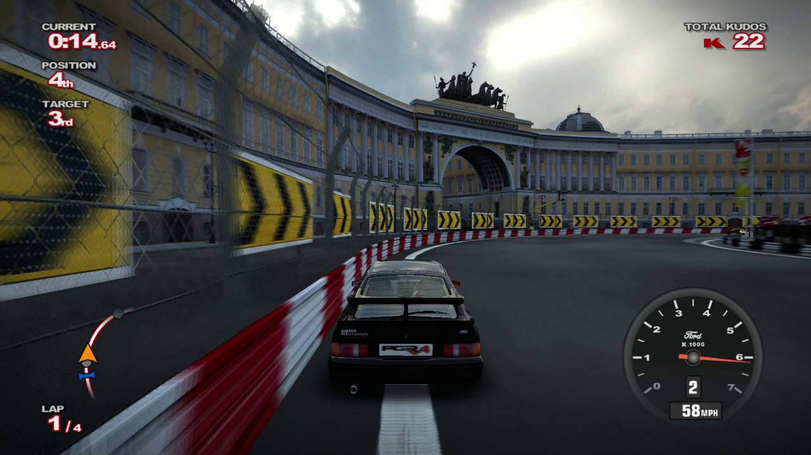
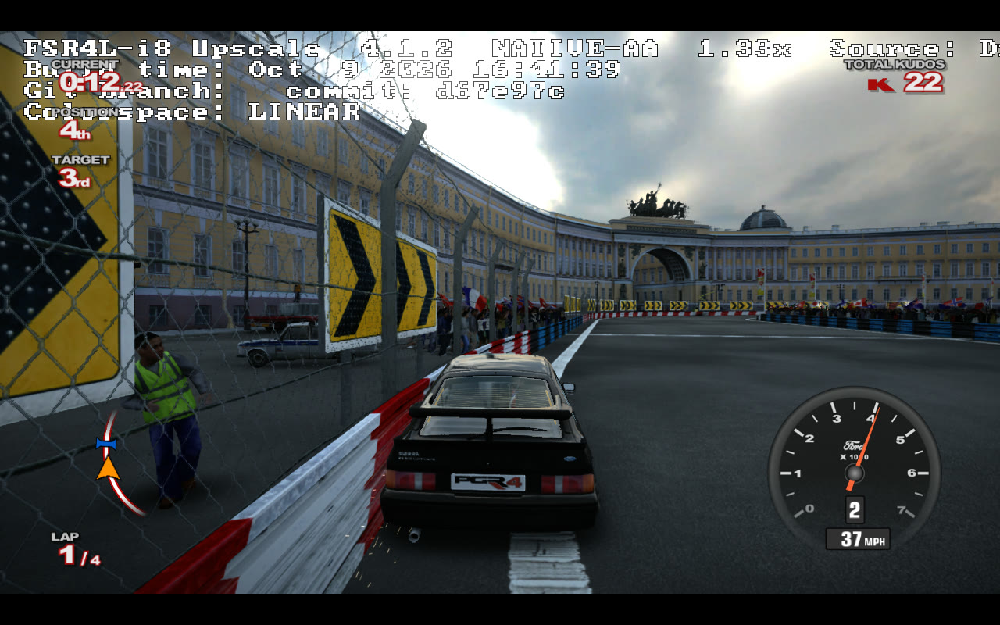

# pgr4-native

A native Direct3D 12 renderer for a static recompilation of Project Gotham Racing 4 (Title
Update #2), built on the [ReXGlue](https://github.com/rexglue/rexglue-sdk) SDK with fixes from
[Xenia Canary](https://github.com/xenia-canary/xenia-canary). It builds on the core work of
[safzanpirani/pgr4-native](https://github.com/safzanpirani/pgr4-native), which grew out of
[MTR-PGR4](https://github.com/MissingThePixel/MTR-PGR4) and, before it,
[PGR4-Recomp](https://github.com/beatrixzy/PGR4-Recomp)





## Building and running

Most people should grab the latest release from https://github.com/shaunsingh/pgr4-native/releases,
the instructions below are for active development of the latest changes etc

The build runs on Linux and cross-compiles the Windows executables with clang-cl. They run under
Proton, or on Windows. You need your own PGR4 disc, extracted, and Title Update #2, either as its
package or as its two files. The disc is region-free and the PAL one matches the NTSC one file for
file, so either works, and `--user_language` picks the language. This repository contains no game
data, and the C++ that the build generates from the game's executables must not be published.

```sh
scripts/fetch-xwin.sh          # MSVC CRT and Windows SDK (accepts Microsoft's license)
scripts/build.sh --game <disc folder> --update <title update package or folder>
scripts/play.sh --install      # install the build and write the Steam desktop entries
scripts/play.sh                # play
scripts/play.sh --debug        # play with logs, the frame CSV, marks (F12) and a CPU profile
scripts/play.sh --fgmod        # play with FSR 4's Lite model through OptiScaler (Insert: its menu)
scripts/deck-run.sh deck <tag> --refresh 90 --hold 45 --output eDP-1   # scripted race with timings
```

After `play.sh --install`, Steam's "Add a Non-Steam Game" lists "PGR4 (native renderer)". Add it
without a compatibility tool, since the script starts Proton itself. DLC copied off a console as
STFS packages goes in the game folder's `Content\`, next to the title update's package.

## Flags

Settings go on the command line (`--name=value`) or in `pgr4_recompiled.toml` next to the
executable. `games/pgr4/pgr4_recompiled.toml` holds the release settings. The game's Options
menu has the port's own Display and Developer pages, which save to `userdata/pgr4_settings.toml`
over `pgr4_recompiled.toml`.

| Flag | Default | Effect |
|---|---|---|
| `--pgr4_native` | false | Run the native renderer beside the Xenos plugin, in a debug window |
| `--pgr4_native_primary` | false | Make the native renderer the game's output (implies `--pgr4_native`, sets `--gpu_skip_draws`) |
| `--pgr4_native_renderer_switch` | true | In primary mode, F9 (`bind_renderer_switch`) switches between the native renderer and the Xenos plugin |
| `--pgr4_native_classic` | false | In primary mode, start on the Xenos plugin, as after F9 (the Display settings' Renderer) |
| `--pgr4_native_debug_keys` | true | Let F7, F8 and F9 do what they do (the Developer settings' Debug keys) |
| `--pgr4_native_replace_draws` | true | In primary mode, the guest D3D's DrawIndexedVertices builds no command packets |
| `--pgr4_native_render_thread` | true | Record and submit on a render thread, so the game thread only captures each call |
| `--pgr4_native_submit_draws=<n>` | 256 | Submit the frame so far every n draws (0 submits once per frame) |
| `--pgr4_native_async_pipelines` | true | Compile new pipelines on worker threads and skip the draws that need them |
| `--pgr4_native_pipeline_threads=<n>` | 0 | Number of pipeline compile threads (0 uses a quarter of the hardware threads, 1 to 4) |
| `--pgr4_native_pipeline_wait` | true | Hold back a frame that skipped draws and wait for their pipelines, up to 0.5 s |
| `--pgr4_native_generic_pipelines` | true | Let a draw whose specialized pipeline is still compiling use the unspecialized one if it is ready |
| `--pgr4_native_pipeline_cache` | true | Keep shaders and pipelines across runs and compile them at start-up |
| `--pgr4_native_bool_specialize` | true | Translate shaders for each draw's bool constants, without the branches |
| `--pgr4_native_resolve_specialize` | true | Compile a copy shader for each kind of resolve |
| `--pgr4_native_dynamic_depth_bias` | true | Set polygon offset per draw instead of per pipeline |
| `--pgr4_native_texture_capture_order` | true | Bind textures as they were when the game queued the draw |
| `--pgr4_native_texture_memory_soft_mb=<n>` | 512 | Above this much texture memory, destroy textures unused for `_soft_lifetime_s` (30) seconds (0 means no limit) |
| `--pgr4_native_texture_memory_hard_mb=<n>` | 1024 | Above this much texture memory, destroy the least recently used textures (0 means no limit) |
| `--pgr4_native_msaa=<n>` | 2 | Samples per pixel of the 3D scene's MSAA when the upscaler is off: 1, 2 (the game's own), 4 or 8 (fewer if the GPU lacks them) |
| `--pgr4_native_upscaler` | false | Antialias and upscale the 3D scene with FidelityFX Super Resolution instead of MSAA (F7 switches, F8 shows its debug view: `--pgr4_native_fsr_debug`). OptiScaler and FSR 4: `scripts/release/README.md`, "Upscaling" |
| `--pgr4_native_upscaler_width=<n>` | 1280 | Width the upscaler's scene renders at, 320 to 1280 (853 for FSR's Quality, 640 for Performance) |
| `--pgr4_native_upscaler_height=<n>` | 720 | Height the upscaler's scene renders at, up to the render height (720 for Quality at 800, 400 for Performance) |
| `--pgr4_native_upscaler_target_fps=<n>` | 0 | Lower the upscaler's render size each frame, from the width and height down to `_min_height`, while the GPU's time per frame is above 90 % of this frame rate's (0 keeps a fixed size) |
| `--pgr4_native_upscaler_min_height=<n>` | 360 | With a target frame rate, the least height the upscaler's scene renders at, down to a quarter of the render height |
| `--pgr4_native_frame_generation` | false | With the upscaler on and the frames paced (`--pgr4_native_frame_latency` above 0), show a frame FidelityFX Frame Generation makes between each two, the game at half the display's refresh rate. `scripts/release/README.md`, "Frame generation" |
| `--pgr4_native_fsr_debug` | false | FidelityFX's debug views of the upscaled scene and the generated frames, and with FSR 4 AMD's watermark of the model it runs (F8 switches; the Developer settings' FSR debug view) |
| `--pgr4_native_anisotropy=<n>` | 1 | Minimum anisotropic filtering (2, 4, 8 or 16) for linearly filtered textures with mips. 1 keeps the game's own, and the release settings use 16 |
| `--pgr4_native_frame_latency=<n>` | 3 | In primary mode, begin a frame once the display has shown the frame n before it (1 to 3, or 0 for the game's own vblank pacing) |
| `--pgr4_native_present_interval=<n>` | 1 | With vsync, show each frame for n display refreshes (1 to 3), so the game runs evenly at the refresh rate over n: 90, 45 or 30 fps at 90 Hz (the Display settings' Frame rate) |
| `--pgr4_native_low_latency` | true | Begin each frame as late as the time recent frames waited for the display allows |
| `--pgr4_native_latency_margin_us=<n>` | 4000 | With low latency on, how long before its display slot the GPU should finish a frame |
| `--pgr4_native_hdr` | true | Output HDR10 when the display supports it (under Proton, set `DXVK_HDR=1`) |
| `--pgr4_native_hdr_peak_nits=<n>` | 0 | Peak luminance the HDR highlights are fitted to (0 uses the display's, or 1000 if it reports none) |
| `--pgr4_native_hdr_paper_white=<n>` | 400 | Luminance of SDR white in HDR output, in nits |
| `--pgr4_60fps` | false | Present every vblank instead of at the game's 30 FPS interval, when the native renderer does not pace the frames |
| `--pgr4_automatic_keep_revs` | true | The automatic transmission shifts down once the engine would run under 90 % of the car's upshift point in the lower gear (the game's own factor is 0.82 to 0.9), keeping the revs and a turbo's boost up |
| `--pgr4_headlights=<race\|on\|off>` | race | The lights of every car and bike: as the race's lighting has them, on or off. F5 (`bind_headlights`) switches them from what they show, for the rest of the session |
| `--pgr4_game_debug_menus` | false | Show the debug entries of the game's own menus |
| `--content_root=<dir>` | `<game>\Content` | Folder of content packages (title update, DLC) installed at startup |
| `--user_language=<n>` | 1 | The game's language: 1 English, 2 Japanese, 3 German, 4 French, 5 Spanish, 6 Italian, 7 Korean, 8 Traditional Chinese, 10 Simplified Chinese, 11 Polish, 12 Russian |
| `--pgr4_native_csv=<file>` | off | Write per-frame counters and CPU times to this file |
| `--pgr4_native_profile` | false | Add the draw path's CPU time per stage to the CSV |
| `--pgr4_native_gpu_timing` | false | Log GPU time per pass (`_shaders` times per shader pair instead) |
| `--pgr4_native_capture_dir=<dir>` | off | Folder for captures, marks and draw logs. A `capture.request` file there or F12 takes a capture, and `draw-debug.txt` there is read |
| `--pgr4_native_capture_xenos` | true | Also capture the Xenos plugin's frame and the PSNR between the two, holding the game thread. When false, only the native PNG is written, from another thread |
| `--pgr4_native_glitch_catch=<prefix>` | off | Keep the last 5 s of frames and write whole-image jumps and marks to `<prefix>glitch-<frame>.rec` and `mark-<frame>.rec` |
| `--pgr4_native_mark_audit=<n>` | 0 | With each mark, log the next n frames' draws and check their shaders, registers and shared memory against the guest's |
| `--pgr4_native_draw_log_from=<n>` | -1 (off) | Log every draw of `_draw_log_frames` (1) frames, starting at native frame n |
| `--pgr4_native_coherency_check` | false | Check vertex and index data and registers against guest memory (slow) |
| `--pgr4_native_track_verify` | false | Check the state tracker against the guest's register shadow after each draw (slow) |
| `--pgr4_native_gpu_serialize` | false | Wait for the GPU at the end of every frame (slow) |

The `REXCVAR_DEFINE_*` lines in `src/` and `patches/` describe the rest.

## Changes

Renderer:

- Draws from the game's own Xbox 360 D3D calls instead of emulating the GPU, so each draw runs
  once at full size, without the console's EDRAM tiling. The Xenos plugin stays in the binary
  for comparison, one key away.
- The game thread captures each call and a render thread records it. The frame is submitted in
  parts as it is recorded.
- Shaders go through ReXGlue's DXBC translator and are specialized for bool constants and
  texture signs. Pipelines compile on worker threads and are stored and prewarmed across runs.
  No frame is shown with draws missing.
- Textures are untiled on worker threads, which also record their uploads ahead of the frame's
  render passes. Texture memory is bounded, and each draw binds textures as they were when it
  was queued.
- Resolves run through compute shaders specialized for each kind. Guest clears are deferred and
  merged.
- The renderer presents from the game's own window, so gamescope flips it directly. It applies
  the display controller's gamma ramp, outputs HDR10, and can add anisotropic filtering.
- Frames are paced on the display with a latency sleep. Motion blur is scaled to the frame time,
  so it is as long as at 30 FPS.

Game (`games/`):

- Title Update #2 and DLC work as the packages players have, installed and applied at startup
  the way Xenia Canary does it.
- Register-as-local code generation, profile-guided optimization and a Zen 2 target.
- Garage walking works at high frame rates, the car preview no longer freezes in its search, and
  the garage's Geometry Wars cabinet starts its own game and returns to PGR4.

SDK (`patches/`):

- Less CPU time and fewer wineserver requests under Proton. The command processor and timer
  threads block instead of polling, high-resolution waits stay in the process, resuming a running
  thread and querying a priority no longer reach the server, guest physical memory is committed
  with its section, the pad is read on a timer thread, and `db16cyc` becomes a spin-wait hint.
- Code generation unpacks `vupkd3d128` NORMPACKED64 correctly. The shader translator samples
  computed-LOD fetches with `sample_b` and drops sign handling for textures known to be unsigned.
- Presenting on the display's vblank, and statistics for guest frames and the command stream.
- XMA decoding fixes, and a decoder flush instead of a reopen for each stream. Canary's XMP music
  player, with the game's own music volume read from the save.
- Keyboard prompts with default text, key binds that fire once per press, installation of title
  update and content packages, and a check that the loaded image is the one the code was
  generated from.

## License

MIT ([LICENSE](LICENSE)). Third-party notices: [THIRD_PARTY_NOTICES.md](THIRD_PARTY_NOTICES.md).
